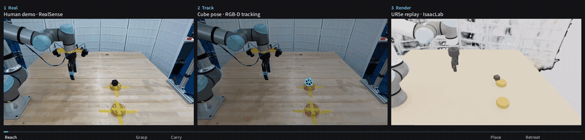
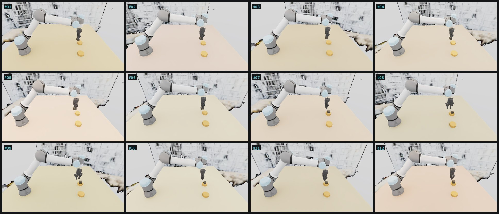
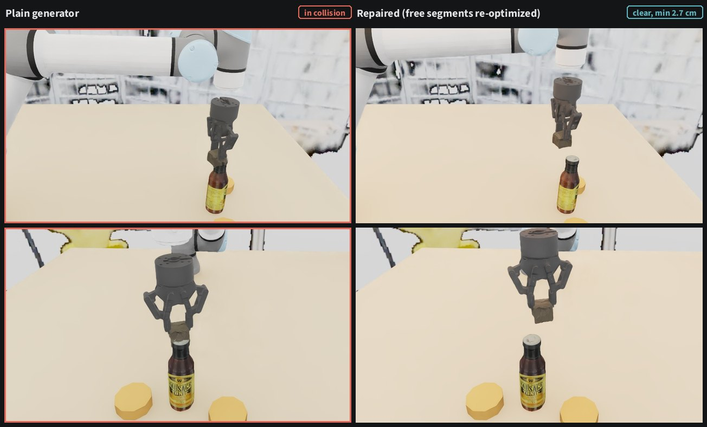
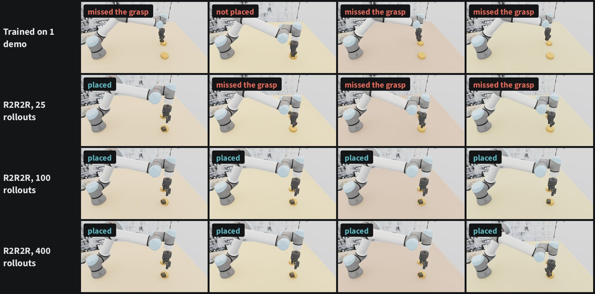
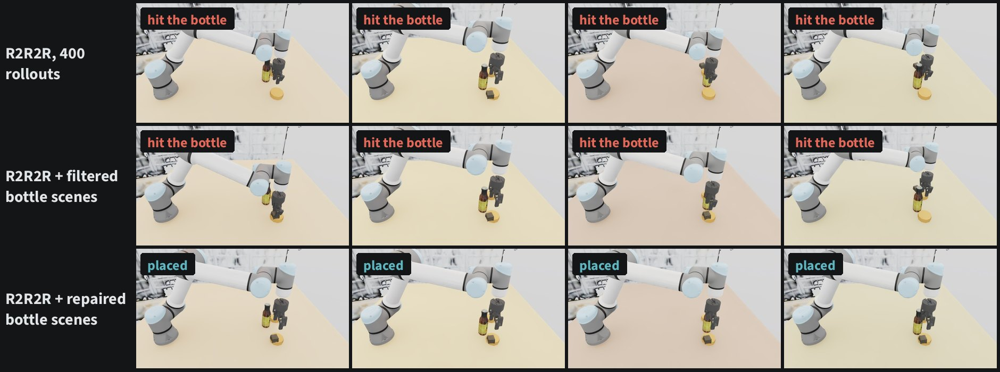
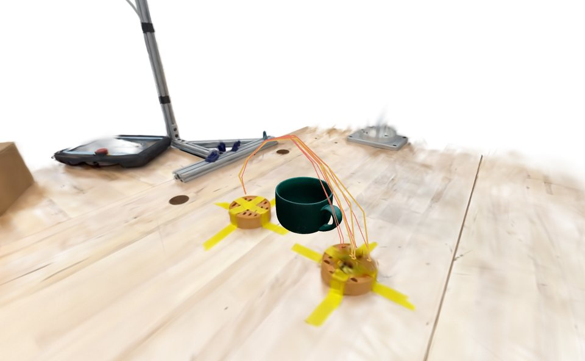
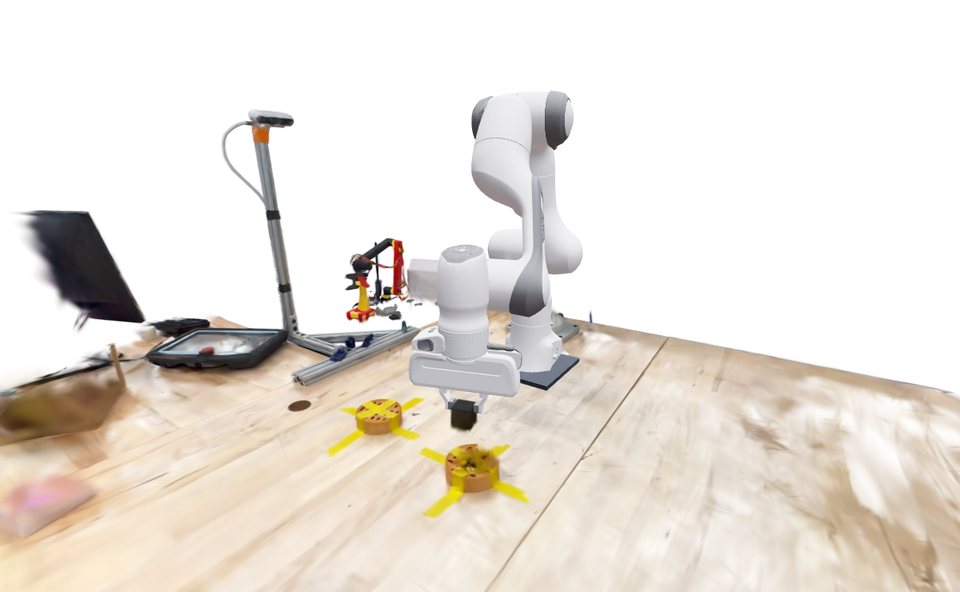
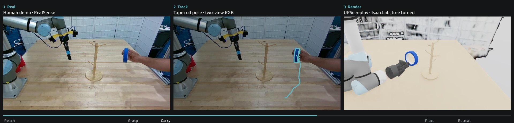
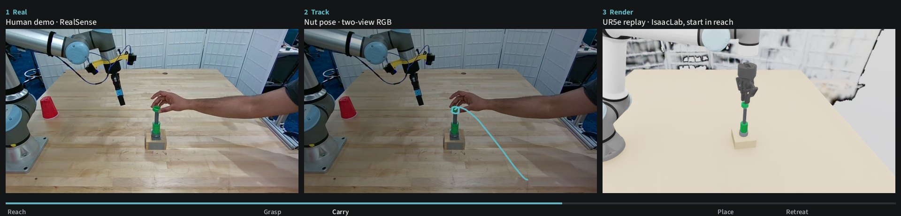
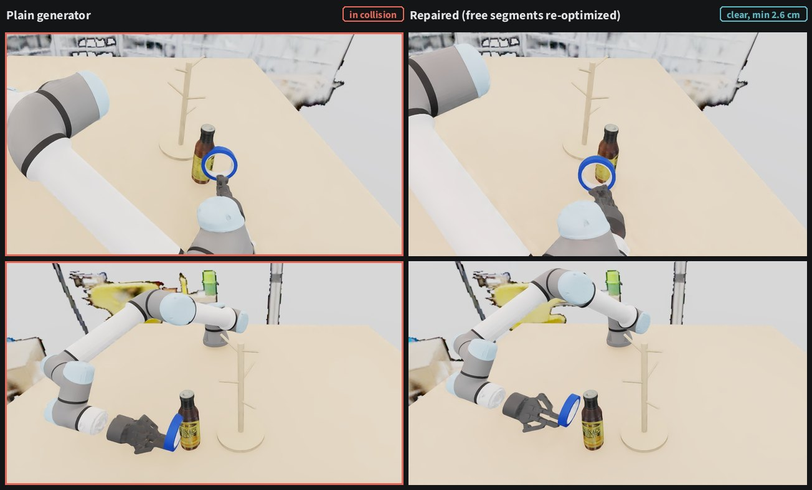

# One human demo → robot demonstrations, on a UR5e

A single human demonstration on a real UR5e bench, recorded by two calibrated RealSense cameras and
a phone scan, turned into robot demonstrations for a UR5e + Robotiq 2F-85 without teleoperation.
This work is built on top of [Real2Render2Real](https://github.com/uynitsuj/real2render2real)

**Project page with videos and an interactive 3D replay: https://ur10.github.io/projects/real2render2real/**



*Left to right: the human demo from the front RealSense, the tracked 6-DoF cube pose drawn on the
same frame, and the UR5e replay rendered in IsaacLab from the same calibrated camera.*

## What it does

| Step | What happens | Result on this bench |
|---|---|---|
| **Scan** | Gaussian splat of the bench from a phone video. The RealSense views are registered into the scan's COLMAP model to recover metric scale and the scan-to-robot transform. | Two independent scale estimates agree to 0.2%; 4 mm median registration residual; camera centres within 8 mm |
| **Track** | The cube's pose per frame from both depth cameras: the scanned cube model fitted with ICP, re-detected on fast lifts, kept consistent across the cube's 24 symmetric orientations. | Box overlay stays on the cube in the camera that was not used for tracking |
| **Embody** | UR5e + Robotiq 2F-85 URDF in the calibrated base frame, gripper mount fitted against the real images. | Simulated cameras and robot line up with the real ones |
| **Render** | IsaacLab kinematic replay: IK follows a grasp on the tracked cube; start pose jitter + trajectory interpolation, randomized lighting, camera and table appearance; a feasibility filter rejects IK error, joint-limit violations and finger–fixture contact. | 12 / 12 randomized rollouts pass |
| **Repair** | Insert an object the demo never saw (a scanned bottle), check the generated motion against it and re-optimize only the free segments; the grasp, lift-off, set-down and release stay as generated. | 21 bottle placements on the route: 5 valid demos with the filter alone, 17 with repair |



### Why the tracker is different from the paper

The paper tracks objects with RSRD (DINO features + a differentiable splat). On this bench the cube
is small (≈4 cm), black and about a metre from the cameras, and RSRD slid off it onto the fixture
even after the fixes in `patches/` (metric depth loss, calibrated first-frame pose, NaN handling).
With two calibrated RGB-D cameras the motion is easier to recover geometrically, so
`pipeline/track_cube_rgbd.py` replaces it. The second camera validates the track independently.

## Obstacles and demo repair



*Same scene and grasp. Left: the warped demo carries the cube through the bottle (outlined red
while in collision; the bottle is visual-only, so the arm passes through it in the render). Right:
the repaired motion clears it by 2.7 cm.*

Warping the demonstrated path only works in the scene it was recorded in. `pipeline/demo_repair.py`
checks a generated motion against inserted obstacles and repairs it:

- **Collision model.** Spheres over the UR5e links, the 2F-85, the wrist-camera bracket and the held
  cube, against the table plane, the fixtures and the inserted objects (vertical cylinders or boxes).
- **What is kept.** The straight descent to the grasp, closing, lift-off and set-down near the
  fixtures, release and the retreat are pinned to the generated poses. Only the transit to the
  pre-grasp and the middle of the carry are re-optimized.
- **Solve.** One joint-space trajectory optimization (jaxls Levenberg-Marquardt): stay close to the
  generated joints, smooth velocity and acceleration, a collision hinge, pinned poses, tool upright
  while carrying, joint and per-joint velocity limits. It runs from the generated motion and from
  versions bent over and around the obstacle. A candidate is accepted only if a denser re-check
  keeps at least 5 mm from the obstacle, and the cube's four symmetric grasp yaws are tried
  before a rollout is rejected.
- **Outcomes.** Valid as generated, repaired, or rejected because the obstacle blocks a pinned
  segment. The held cube's poses are recomputed from the repaired arm motion, so the rendered
  observations stay consistent.

Sweep over 45 bottle placements along and across the cube's route (24 overlap a fixture and are
skipped; `pipeline/sweep_repair.py`, `pipeline/plot_sweep_map.py`):

| Outcome | Placements |
|---|---|
| Already collision-free | 5 |
| Repaired | 11 |
| Repaired after switching to another grasp yaw | 1 |
| Rejected: the bottle blocks the grasp descent or the set-down | 4 |
| Repair failed | 0 |

Repaired paths keep at least 1.5 cm from the bottle (median 2.7 cm); the largest gripper detour from
the warped path has a median of 6.4 cm (max 9.9 cm).

The demo track is also cleaned up before planning: while the cube sits on the place fixture the
tracked pose tilts it by up to 23°, and during the carry it spins 80°, which under the cube's 90°
symmetry is the same as −10°. The planner levels the cube and uses the smallest equivalent yaw.

## Does more diverse data give a better policy?

The point of generating demonstrations is training data. The same visuomotor policy (ResNet-18 over
both RealSense views + joint state, 16-step joint action chunks; `pipeline/policy.py`,
`pipeline/train_policy.py`) is trained on datasets of increasing diversity, all generated from the
one tracked demo, and evaluated closed-loop in the twin on the same 96 held-out scenes per set
(`sim/eval_ur5e_cube_policy.py`, scenes in `assets/outputs/ur_cube/eval/scenes.json`).

- **Clean:** the cube starts at a held-out offset on the pick fixture, no obstacle.
- **Blocked:** a bottle stands on the route so the plain generated motion would hit it, but a
  collision-free motion exists.

Success means the cube ends released on the goal fixture without the arm or held cube ever entering
the bottle. Contact is not simulated: the cube attaches when the gripper closes around it, as in data
generation.

| Training data | Rollouts | Clean scenes | Blocked-route scenes |
|---|---|---|---|
| 1 demo, replayed | 1 | 3/96 (3%) | 0/96 (0%) |
| R2R2R | 25 | 34/96 (35%) | 1/96 (1%) |
| R2R2R | 100 | 82/96 (85%) | 0/96 (0%) |
| R2R2R | 400 | 90/96 (94%) | 1/96 (1%) |
| R2R2R + bottle scenes, filtered | 400 | 92/96 (96%) | 4/96 (4%) |
| R2R2R + bottle scenes, repaired | 400 | 91/96 (95%) | 82/96 (85%) |

95% Wilson intervals are in `assets/outputs/ur_cube/eval/summary.md`. The bottle sets are 200 R2R2R
rollouts + 200 with a bottle. "Filtered" keeps only bottle scenes where the unrepaired motion is
already clear, so the policy never sees a detour; "repaired" uses `demo_repair.py`.




More randomized data takes the policy from 3% to 94% on clean scenes. None of that transfers to a
blocked route, and filtering doesn't help either; with repaired bottle scenes in the data the policy
goes around the bottle in 85% of blocked scenes, without losing clean-scene success. These are twin
results; real-robot trials are next.

Everything is in one script: `pipeline/policy_experiment.sh gen|build|train|eval`.

## Trajectory interpolation with object permutations



`pipeline/make_traj_permutations.py` takes the generator's interpolated trajectories (new cube
starts, warped demo) and places scanned objects on and beside the route: the bottle, a mug and a
cereal box from Google Scanned Objects (`pipeline/prep_gso_obstacle.py`, cylinder or box collision
proxy). Each object/start pair is run through the repair planner. Over 8 placements x 6 starts:
48 trajectories, 37 collide as generated; filtering keeps 11, repair keeps 43 and rejects 5 (the
object blocks the grasp, lift-off or set-down). `pipeline/make_traj_viser.py` writes the figures
and an interactive viser recording.

## Other embodiments



The robot motion comes from the object's track plus a grasp, so it is not tied to the UR5e.
`pipeline/retarget_embodiment.py` runs the generator's phases for the same cube trajectory and grasp
on a UR5e, a UR10e (same 2F-85 and mount; `build_ur5e_robotiq_urdf.py --ur-type ur10e`) and a Franka
Panda standing on the table (`pipeline/build_panda_urdf.py`), with whole-sequence IK. All three
track every TCP target to under 0.01 mm. `pipeline/make_embodiment_viser.py` writes the viser
replays. The UR10e and Panda are not yet rendered through the Isaac camera pipeline or used for
training.

## Two more tasks from colour video only




Hanging a roll of tape on a mug tree and putting a nut on a bolt, each from one human demo
recorded by the same two RealSense cameras, but as colour video only (no depth, no camera
metadata). The cameras had not moved since the RGB-D capture (static points match to about 1 px),
so their calibration is reused (`assets/outputs/ur_tape/realsense_calib.json`). Code in
`pipeline_rgb/`.

- **Measured shapes instead of scans.** Each object is a simple shape whose size is fitted to its
  colour outline in both views: the tape roll is a 51.4 mm-radius band on a 41.3 mm core, 24 mm wide
  (`fit_tape_dims.py`); the nut a 32 mm ring with a 21 mm hole, 16 mm thick (`fit_ring_dims.py`).
  The mug tree and the bolt stand are measured from points and outlines in both views
  (`measure_mug_tree.py`, `measure_bolt_stand.py`).
- **Two-view silhouette tracking.** Per frame, the shape's z-buffered outline is fitted to the
  object's colour mask in both views at once, ignoring hand pixels and same-coloured scenery
  (`track_tape_rgb.py`), with re-detection from triangulated colour blobs after fast moves. While
  the hand hid the nut from the right camera for about 1.3 s, the front view alone carries the track:
  positions on its rays, depth interpolated between the two-view poses at either end
  (`bridge_one_view.py`).
- **Demo clean-up**, as for the cube: rest poses levelled; the roll tilted the shorter way (82 deg
  instead of 98 deg) using its end-for-end symmetry; the nut centred on the rod (tracked 1.4 mm off,
  2.9 mm of hole clearance) and lowered onto it from above the tip (`clean_tape_track.py`,
  `clean_nut_track.py`).
- **Planning** (`tape_plan.py`): the grasp pinches the tape band from the roll's top face, or the
  nut across its outside, at 12 positions around the rim; each is planned with whole-sequence IK
  and checked with the sphere model against the bench and the fixture; the cheapest valid one is kept.
- **What did not carry over.** As recorded, the hang is not reachable for the UR5e: the branch the
  human used points away from the robot, and the roll was pushed to 1.9 cm from the post, which
  leaves no room for the gripper. `sweep_tree_yaw.py` shows it becomes plannable when the tree is
  turned 230-270 deg about its post, so the twin's tree is turned 250 deg, and the demo is
  released once the roll is 4.5 cm onto the branch. The nut's human start is 0.93 m from the base,
  beyond reach, so generated starts are moved 14 cm closer.

| Task | Generated rollouts that pass |
|---|---|
| Cube between fixtures (RGB-D) | 448 / 448 |
| Tape roll onto the mug tree | 25 / 48 (rejected: fingertips reach the bench as the roll tips up) |
| Nut onto the bolt | 48 / 48 |

The tape and nut rollouts are not yet used to train policies.

### Scene edits, permutations and 3D replays for the two tasks



`pipeline_rgb/ring_repair.py` runs the cube's demo repair (`demo_repair.DemoRepair`) on the ring
tasks with their own grasp candidates (the ring planner's rim positions), pinned segments (the
lift-off, and the last stretch onto the branch or the rod), a ring of spheres for the held object
and the fixture's vertical parts as environment; every result is re-checked with the ring planner's
full check, which includes the mug tree's angled branches. `run_ur5e_tape.py --obstacle-xy X Y
--compare` renders the before/after pair; `make_ring_permutations.py` places the scanned bottle,
mug and cereal box on and beside each route:

| Task | Trajectories (placements x starts) | Collide as generated | Kept: filter only -> with repair | Rejected |
|---|---|---|---|---|
| Tape roll | 48 (8 x 6) | 48 | 0 -> 29 | 19 (16 block a fixed segment, 3 no path) |
| Nut | 54 (9 x 6) | 40 | 14 -> 34 | 20 (all block a fixed segment) |

On the nut's short route (22 cm) every object blocks the descent to the nut or onto the rod, so its
placements are beside the route. `make_ring_replay_viser.py` and `make_ring_traj_viser.py` write
the interactive replays (bench splat with the cube task's fixtures painted out, measured meshes).

## Repository layout

```
pipeline/   bench calibration, scan alignment, cube tracking, robot models, demo repair, policy
            training and the policy experiment, media (→ scripts/ur_cube/)
pipeline_rgb/ the RGB-only tasks: measured shapes, two-view tracking, clean-up, planning (→ scripts/ur_tape/)
sim/        UR5e cube pick-and-place simulator, closed-loop policy evaluator, scene and robot
            configs, run scripts
patches/    fixes to upstream Real2Render2Real, RSRD, DiG and hamer_helper
assets/     small bench files: calibrated cameras, scene layout, tracked trajectory, cube mesh, skybox,
            held-out eval scenes
launchers/  generate.sh, headless data generation
install.sh  installs all of the above into a Real2Render2Real checkout
```

Notable patches:
- `real2render2real.patch`: camera manager takes a per-robot camera file; works with viser 0.2.x.
- `rsrd.patch`: metric-depth loss and options for small, distant objects; NaN fixes for missing depth.
- `dig.patch`: stop forcing `TORCH_CUDA_ARCH_LIST=8.9`, which broke JIT builds on other GPUs.
- `hamer_helper.patch`: ViTPose import path; optional lighter person detector for 12 GB GPUs.

## Install

Follow the upstream environment setup first (`env_data_gen.sh` for IsaacLab 4.5 data generation,
`env_real_to_sim.sh` for scanning and tracking). Then:

```bash
git clone https://github.com/ur10/real2render2real-ur5e.git
cd real2render2real-ur5e
./install.sh                      # clones upstream at the pinned commit into ./real2render2real
# or: ./install.sh /path/to/your/real2render2real
```

## Reproduce

Paths below are relative to the Real2Render2Real checkout. The capture is a folder of RGB-D steps
with calibrated `T_cam2base` per camera (`pipeline/rgbd_utils.py` documents the layout); the
bench files from my capture are already in `assets/`, so you can start from step 3.

```bash
# 1. Scan -> robot base (needs the phone scan and the capture)
bash scripts/ur_cube/register_realsense_in_colmap.sh <scan_dir> <capture_dir> 0 <work_dir>
python scripts/ur_cube/scan_to_base_from_colmap.py --help
python scripts/ur_cube/measure_scene_from_rgbd.py --help     # table plane, fixtures, cube

# 2. Track the cube with both RealSense cameras
python scripts/ur_cube/track_cube_rgbd.py --init-traj outputs/ur_cube/traj_ep0_f1_to_f0.json \
    --mesh data/ur_cube/cube_mesh.obj --episode 0 --steps 52 84 \
    --output outputs/ur_cube/traj_ep0_f1_to_f0_rgbd.json

# 3. Robot model and USDs
python scripts/ur_cube/build_ur5e_robotiq_urdf.py
python dependencies/IsaacLab/scripts/tools/convert_urdf.py data/ur5e_robotiq/ur5e_robotiq85.urdf \
    data/ur5e_robotiq/usd/ur5e_robotiq85.usd --fix-base --headless
# not instanceable: with an instanceable cube the renders of envs >= 1 keep the cube at its spawn pose
python dependencies/IsaacLab/scripts/tools/convert_mesh.py data/ur_cube/cube_mesh.obj \
    data/ur_cube/usd_noinst/cube_mesh.usd --collision-approximation none --mass 1.0 --headless

# 4. Generate demonstrations (RGB from both cameras + joint data per rollout)
OMNI_KIT_ACCEPT_EULA=YES launchers/generate.sh . output_data/ur5e_randomized 2 6
OMNI_KIT_ACCEPT_EULA=YES launchers/generate.sh . output_data/ur5e_demo_replay 1 1 --no-augment

# 5. Figures and the interactive replay
python scripts/ur_cube/make_triptych.py --rollout <replay rollout> \
    --traj outputs/ur_cube/traj_ep0_f1_to_f0_rgbd.json --output-dir outputs/ur_cube/media
python scripts/ur_cube/make_rollout_grid.py --successes output_data/ur5e_randomized/successes \
    --output outputs/ur_cube/media/randomized.mp4
python scripts/ur_cube/make_viser_recording.py --rollout <replay rollout> --output-dir outputs/ur_cube/review
python scripts/ur_cube/make_splat_orbit.py --output outputs/ur_cube/media/splat_orbit.mp4  # splat orbit + RealSense wipe

# 6. Obstacle + demo repair
python scripts/ur_cube/prep_gso_obstacle.py              # fetch the scanned bottle, fit its collision cylinder
python dependencies/IsaacLab/scripts/tools/convert_mesh.py data/obstacles/sauce_bottle/model.obj \
    data/obstacles/sauce_bottle/usd/model.usd --collision-approximation none --headless
python scripts/ur_cube/sweep_repair.py && python scripts/ur_cube/plot_sweep_map.py   # offline sweep
TRAJ=outputs/ur_cube/traj_ep0_f1_to_f0_rgbd.json
python scripts/run_ur5e_cube.py --traj $TRAJ --obstacle --output-dir output_data/ur5e_bottle             # repaired
python scripts/run_ur5e_cube.py --traj $TRAJ --obstacle --no-repair --output-dir output_data/ur5e_bottle_reject
python scripts/run_ur5e_cube.py --traj $TRAJ --obstacle --obstacle-xy 0.096 -0.763 --compare --no-augment \
    --num-envs 2 --max-episodes 1 --output-dir output_data/ur5e_repair_compare
python scripts/ur_cube/make_repair_compare.py --run output_data/ur5e_repair_compare \
    --output outputs/ur_cube/media/repair_compare.mp4

# 7. Policies: generate, pack, train, evaluate closed-loop (Isaac on GPU 0, training on $TRAIN_GPU)
bash scripts/ur_cube/policy_experiment.sh all
python scripts/ur_cube/summarize_policy_experiment.py
python scripts/ur_cube/make_eval_grid.py --help                 # rollout grids

# 8. Trajectory interpolation with object permutations (viser 0.2.23 for the recordings)
python scripts/ur_cube/prep_gso_obstacle.py --name Cole_Hardware_Mug_Classic_Blue --output data/obstacles/mug
python scripts/ur_cube/prep_gso_obstacle.py --name Vans_Cereal_Honey_Nut_Crunch_11_oz_box \
    --output data/obstacles/cereal_box --proxy box
python scripts/ur_cube/make_traj_permutations.py --help
uv run --no-project --with viser==0.2.23 --with trimesh --with pillow --with tyro \
    python scripts/ur_cube/make_traj_viser.py

# 9. Other embodiments
# expand ur10e_description to data/ur10e_robotiq/ur10e_raw.urdf first (see build_ur5e_robotiq_urdf.py)
python scripts/ur_cube/build_ur5e_robotiq_urdf.py --ur-type ur10e --out-dir data/ur10e_robotiq --coupling-z 0.04 --tcp-z 0.16
python scripts/ur_cube/build_panda_urdf.py
python scripts/ur_cube/retarget_embodiment.py
uv run --no-project --with viser==0.2.23 --with yourdfpy --with pycollada --with tyro \
    python scripts/ur_cube/make_embodiment_viser.py

# 10. The RGB-only tasks (videos in $UR_RGB_VIDEOS, default ~/Downloads/ur_human_capture/videos)
python scripts/ur_tape/fit_tape_dims.py && python scripts/ur_tape/measure_mug_tree.py
python scripts/ur_tape/track_tape_rgb.py --episode 1 --output outputs/ur_tape/traj_ep1_hang.json
python scripts/ur_tape/clean_tape_track.py
python scripts/ur_tape/sweep_tree_yaw.py                     # which tree turns make the hang plannable
python scripts/ur_tape/fit_ring_dims.py --frames 4:0 4:465 --inits " -0.136,-0.92,-0.012,0,0,1" "0.086,-0.638,0.172,0,0,1" \
    --output outputs/ur_nut/nut_dims.json && python scripts/ur_tape/measure_bolt_stand.py
python scripts/ur_tape/track_tape_rgb.py --episode 4 --colour green --ignore-static --roi-r 0.06 --obj-name nut \
    --dims-file outputs/ur_nut/nut_dims.json --output outputs/ur_nut/traj_ep4_place.json
python scripts/ur_tape/bridge_one_view.py --track outputs/ur_nut/traj_ep4_place.json --episode 4 --gap 183 226 \
    --output outputs/ur_nut/traj_ep4_place.json && python scripts/ur_tape/clean_nut_track.py
python scripts/ur_tape/build_tape_assets.py                  # meshes; convert to USD as in its docstring
scripts/ur_cube/isaac_run.sh outputs/ur_tape/logs/gen.log "^\[INFO\]: Episode 12:" scripts/run_ur5e_tape.py --task tape \
    --traj outputs/ur_tape/traj_ep1_hang_clean.json --tree-yaw 240 260 --max-episodes 12 --output-dir output_data/tape/r2r2r
scripts/ur_cube/isaac_run.sh outputs/ur_nut/logs/gen.log "^\[INFO\]: Episode 12:" scripts/run_ur5e_tape.py --task nut \
    --traj outputs/ur_nut/traj_ep4_place_clean.json --start-offset 0.08 0.12 --max-episodes 12 --output-dir output_data/nut/r2r2r
# scene edits + permutations + 3D (viser 0.2.23 for the recordings)
scripts/ur_cube/isaac_run.sh outputs/ur_tape/logs/compare.log "^\[INFO\]: Episode 1:" scripts/run_ur5e_tape.py --task tape \
    --traj outputs/ur_tape/traj_ep1_hang_clean.json --num-envs 2 --max-episodes 1 --no-augment --save-scale 1 \
    --obstacle-xy 0.004 -0.737 --compare --output-dir output_data/tape/repair_compare
python scripts/ur_cube/make_repair_compare.py --run output_data/tape/repair_compare --output outputs/ur_tape/media/tape_repair_compare.mp4 \
    --crops 301 178 1264 719 0 116 1073 719
python scripts/ur_tape/make_ring_permutations.py --task tape
python scripts/ur_tape/make_ring_permutations.py --task nut --lateral -0.16 0.16 --min-lateral 0.05 --fraction 0.0 1.0 --seed 5
uv run --no-project --with viser==0.2.23 --with yourdfpy --with pycollada --with h5py --with trimesh --with pillow --with tyro \
    python scripts/ur_tape/make_ring_replay_viser.py --task tape --rollout <replay rollout> --output outputs/ur_tape/viser/tape_replay.viser
uv run --no-project --with viser==0.2.23 --with trimesh --with pillow --with tyro python scripts/ur_tape/make_ring_traj_viser.py --task tape
```

Tested on Ubuntu 22.04, driver 580, Isaac Sim 4.5 / IsaacLab, RTX 3080 Ti (12 GB). One GPU job per
card: the tracker and Isaac Sim don't fit together on 12 GB.


## Acknowledgements

Built on Real2Render2Real by Justin Yu, Letian Fu, Huang Huang, Karim El-Refai, Rares Andrei Ambrus,
Richard Cheng, Muhammad Zubair Irshad and Ken Goldberg, and on RSRD, DiG, trajgen, IsaacLab, jaxmp
and jaxls. The obstacle bottle is the Google Scanned Objects model
`Weston_No_33_Signature_Sausage_Tonic_12_fl_oz`, the mug `Cole_Hardware_Mug_Classic_Blue` and the
cereal box `Vans_Cereal_Honey_Nut_Crunch_11_oz_box` are Google Scanned Objects (CC-BY 4.0, Google
LLC), downloaded by `pipeline/prep_gso_obstacle.py` and not redistributed here. The Panda model is
from example-robot-data and the UR10e from Universal Robots' ROS description, both fetched with
robot_descriptions.

```bibtex
@misc{yu2025real2render2realscalingrobotdata,
  title={Real2Render2Real: Scaling Robot Data Without Dynamics Simulation or Robot Hardware},
  author={Justin Yu and Letian Fu and Huang Huang and Karim El-Refai and Rares Andrei Ambrus and Richard Cheng and Muhammad Zubair Irshad and Ken Goldberg},
  year={2025},
  eprint={2505.09601},
  archivePrefix={arXiv},
  primaryClass={cs.RO}
}
```

MIT License; see `LICENSE`.
