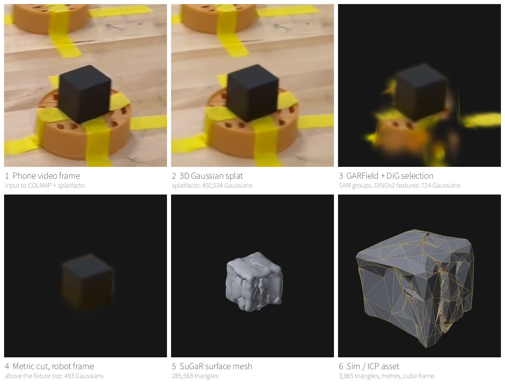
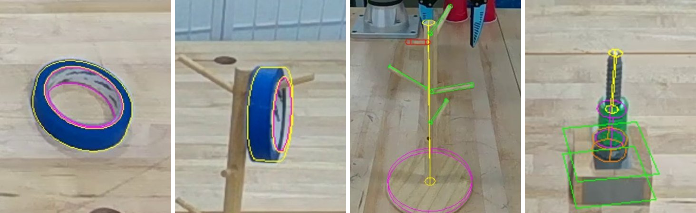

# The model stack: from a phone video to simulation assets, task by task

Real2Render2Real turns one human demonstration into robot training data. Before any robot motion
is planned, the bench and each object have to exist as geometry in the robot's frame. This page
documents how that happens for the three UR5e tasks: which model does what, what it produced on
this bench, where it failed, what replaced it, and where each output ends up in a generated
training sample. An 80-second video of the whole pipeline, with the numbers at each stage, is at the
top of the [project page](https://ur10.github.io/projects/real2render2real/#r2-pipeline)
(`pipeline/make_pipeline_renders.py`, `pipeline/make_pipeline_video.py`).

## Task by task

The bench comes from one phone scan for all three tasks. The object models depend on what was
recorded: the cube was in the scan and its demo has depth, so it goes through the learned chain;
the tape roll and the nut were recorded later, in colour only and never scanned, so they are
measured shapes fitted to their outlines in the two calibrated views.

| Stage | Cube (RGB-D demo) | Tape roll (RGB demo) | Nut (RGB demo) |
|---|---|---|---|
| Bench | **COLMAP + Gaussian splat**, registered to the robot base frame (shared) | same scan; the cube's fixtures painted out of the 3D views | same |
| Find the object | **GARField (SAM) + DiG (DINOv2)**, then a metric cut | blue HSV mask per view, skin pixels ignored | green HSV mask; the stand's green spacers ignored |
| Object shape | **SuGaR** mesh → 3,965-triangle asset | measured roll: R 51.4 mm, core 41.3 mm, 24.0 mm wide | measured ring: 32.2 mm across, 21.4 mm hole, 15.7 mm thick |
| Fixtures | table plane and fixtures from RGB-D | mug tree triangulated from both views | bolt stand triangulated and fitted |
| Track | two-view depth ICP of the SuGaR mesh (RSRD drifted) | two-view silhouette fit, 5-DoF | silhouette fit + one-view bridge (1.3 s) |
| Clean-up | nearest of 24 symmetric orientations; levelled rests | end-for-end symmetry; release 4.5 cm onto the branch | centred on the rod, lowered from above the tip |
| In the rendered images | SuGaR mesh (texture's mean colour) + splat dome light | measured meshes in measured colours + splat dome light | same |
| Valid rollouts | 448 / 448 | 25 / 48 | 48 / 48 |

The sections below go through the cube's chain model by model, then the measured shapes.



*Panels 1–5 are drawn from the same phone-scan camera, so the stages line up pixel for pixel.
(1) A frame of the phone video. (2) The splatfacto Gaussian splat rendered from that camera.
(3) The GARField + DiG selection after clicking the cube: it includes the fixture's top and its
tape. (4) The same Gaussians cut above the fixture top in the robot base frame: the cube only.
(5) SuGaR's surface mesh of those Gaussians. (6) The cleaned mesh in the cube frame, in metres,
which the ICP tracker and IsaacLab use. Made by `pipeline/make_model_stack_figure.py`.*

## The cube's chain at a glance

| # | Stage | Model | What goes in → what comes out | On this bench |
|---|---|---|---|---|
| 1 | Camera poses | **COLMAP** structure-from-motion | 319 phone frames (1920×1080) → camera poses, sparse points | Two RealSense views registered into the same model give the metric scale |
| 2 | Scene appearance | **3D Gaussian Splatting** (nerfstudio `splatfacto`, 30k steps, SH degree 3) | posed frames → 450,534 Gaussians | Bench background, 3D replays, registration check |
| 3 | Object groups | **GARField**, supervised by **SAM** ViT-H masks | multi-view SAM masks → a scale-conditioned grouping field | Could not separate the cube from the fixture under it at any scale |
| 4 | Object features | **DiG** (Distilled Gaussians), **DINOv2** ViT-B/14 features | splat + GARField → a 64-d feature on every Gaussian, click-to-select | 724 Gaussians selected: the cube plus the fixture top |
| 5 | Metric cut (mine) | geometry, no model | selection → Gaussians above the fixture top, within 3.5 cm of the cube's axis, in the robot frame | 493 Gaussians: the cube only |
| 6 | Surface | **SuGaR** | 493 Gaussians + object-only renders → textured triangle mesh | 285,568 triangles, scan units |
| 7 | Asset (mine) | geometry, no model | SuGaR mesh → cube frame, metres, largest component, decimated → USD | 3,965 triangles, 46.6 × 43.6 × 41.0 mm box |
| 8 | Object motion | **RSRD** (4D-DPM), DINOv2 features + differentiable splat rendering | demo video → per-frame object pose | Tried and patched; slid off the cube onto the fixture. Replaced by two-view RGB-D ICP of the SuGaR mesh |
| 9 | Hand pose | **HaMeR** + ViTPose | demo video → MANO hand mesh, for grasp sampling | Installed and patched, not used: grasps come from the cube's symmetry |

Downstream of perception, the planner uses jaxmp (kinematics) and jaxls (Levenberg–Marquardt
trajectory optimization), IsaacLab / Isaac Sim 4.5 renders the training images, and the policy is
an ImageNet-pretrained ResNet-18 per camera with spatial-softmax keypoints and a 16-step joint
action chunk.

## Each model, in order

### 1. COLMAP: camera poses, and the metric frame

COLMAP recovers the phone's poses and a sparse point cloud, up to an unknown scale and an arbitrary
world frame. A splat built on that frame looks right but sits at the wrong size and place for a
robot. I register the two calibrated RealSense images into the same COLMAP model
(`pipeline/register_realsense_in_colmap.sh`), lift their matched features to 3D with RealSense
depth, and fit a similarity to the robot base frame with RANSAC + Umeyama
(`pipeline/scan_to_base_from_colmap.py`).

- 242 inlier correspondences, **0.324 m per COLMAP unit**.
- An independent scale from the distance between the two camera centres: 0.323 m per unit,
  **0.2% apart**.
- **4.1 mm** median residual; the registered camera centres land 8.2 mm and 4.4 mm from their
  calibrated positions.

Every scan-derived product inherits this transform: the cube mesh's metric size (and so the ICP
template), the first pose of the track, the table and fixture heights the metric cut uses, and the
background dome. The RealSense and simulated camera poses come from the hand-eye calibration, not
from the scan.

### 2. 3D Gaussian Splatting (splatfacto): the bench's appearance

`splatfacto` fits 450,534 anisotropic Gaussians with degree-3 spherical harmonics to the posed
frames (30k steps). Rendered from a calibrated RealSense pose through the similarity above, the
splat lines up with the real frame (`pipeline/render_from_realsense.py`; the wipe at the end of the
project page's orbit video). The splat itself is not rendered inside IsaacLab. It reaches the data
in three ways:

- **Training-image background and ambient light.** `pipeline/make_scan_skybox.py` renders six
  cube-map faces of the bench from above the workspace with gsplat (scan arm, start-pose cube and
  table top removed) and resamples them into the equirectangular dome light IsaacLab lights and
  backgrounds every render with.
- **Interactive 3D replays.** `pipeline/export_splats.py` writes the bench in the robot frame for
  the viser replays; for the tape and nut tasks the cube task's fixtures are painted out of it.
- **Checks.** Blends against real RealSense frames verify the registration, scale included.

### 3–4. GARField (SAM) and DiG (DINOv2): selecting the object

Real2Render2Real gets object Gaussians by clicking in a viewer. Two models make that click
meaningful:

- **GARField** runs SAM (ViT-H, `facebook/sam-vit-huge`) on every training image and distils the
  multi-view masks into a scale-conditioned affinity field over 3D (8k steps): at a given physical
  scale, points in the same group get similar features.
- **DiG** trains a second splat whose Gaussians each carry a 64-d feature distilled from DINOv2
  (ViT-B/14 with registers), grouped with GARField's field (8k steps). Clicking a Gaussian selects
  its group; the "rigid-body state" is saved with object-only renders, masks and cameras, the
  format SuGaR and RSRD read.

**What happened here.** The cube is 4 cm, black, and sits on a 3D-printed fixture taped down with
bright yellow tape. At no GARField scale did the cube come apart from the fixture top: the
selection (panel 3) holds 724 Gaussians including the ring and the tape. I cut it in the robot base
frame instead (`pipeline/filter_rigid_state.py`): keep Gaussians above z = 9.5 mm in the base frame
(the fixture top is at 9.2 mm, the table at −20 mm) and within 3.5 cm of the cube's vertical axis,
then re-export with DiG's own writers so SuGaR and RSRD see the format they expect. 493 Gaussians remain (panel 4). The cut is
only possible because step 1 put the scan in a metric frame with a known table height.

### 6–7. SuGaR: Gaussians to a mesh a simulator can use

A splat has no surface: Gaussians are semi-transparent blobs, so a physics engine, a mesh renderer
and ICP cannot use it directly. **SuGaR** (Surface-Aligned Gaussian Splatting) makes one:

1. **Regularize** (7k iterations, starting from the 493 cut Gaussians): SuGaR's density and
   SDF-normal terms (both weight 0.2) make the Gaussians' density agree with a signed-distance
   function to a surface, which pulls them flat and onto it.
2. **Extract**: sample points on a level set (0.05) of the Gaussian density and run Poisson
   surface reconstruction; decimate to 200k vertices.
3. **Refine** (2k iterations): bind 6 Gaussians to each triangle and optimize mesh and Gaussians
   together against the object-only renders, with a normal-consistency term (0.1); export a
   UV-textured OBJ (285,568 triangles).

I then put the mesh into the trajectory's cube frame in metres (`pipeline/mesh_to_object_frame.py`):
scan units → DiG model units (dataparser transform) → RSRD's object frame → the cube frame (z up,
x/y along the faces), keep the largest connected component (drops SuGaR floaters), decimate to
3,965 triangles, and use the texture's mean colour (decimation drops UVs). IsaacLab's
`convert_mesh.py` turns it into the USD the simulator loads (not instanceable; see the README).

**Quality.** The result is box-like but lumpy (panels 5–6): flat faces come out rippled and one
side has a dent, and its bounding box is 46.6 × 43.6 × 41.0 mm, a few millimetres larger than the
cube (≈4 cm) on two axes. 493 Gaussians on a dark, nearly textureless object are a thin basis for a
surface. It is still good enough for both of its jobs, because the tracker validates against the
second camera and the simulator only needs the shape for rendering.

The SuGaR asset is used in three places:

| Consumer | What it uses | Effect of mesh error |
|---|---|---|
| `pipeline/track_cube_rgbd.py` | ICP template, fitted to both RealSense depth clouds every frame | A biased template biases the cube's centre and so every grasp target; checked by overlaying the fitted cube on both camera views |
| IsaacLab scene (`sim/`) | The visible cube in every rendered training image, both cameras | Silhouette and colour the policy sees |
| Trajectory JSON, figures | `cube_size_m` from the mesh bounds (overlays, triptychs) | Display only |

The planner's collision model does not use the mesh: it uses a nominal 4 cm cube of spheres.

### 8. RSRD: tracking the object, and why it was replaced

RSRD (Robot See Robot Do) tracks the DiG object through the demo video: it renders the object's
Gaussians and their DINOv2 features at a candidate pose and optimizes the pose until the rendered
features match the video's. It is built for objects that fill more of the frame. Here the cube is
about 25 pixels across in the 1280×720 front view, a metre from the camera, and nearly
featureless, so the DINOv2 matches drift to the fixture. I patched RSRD (`patches/rsrd.patch`): RealSense metric depth as a
loss, scan-unit distances, a 2× digital zoom because RSRD rasterizes at 490 px, NaN fixes for
missing depth, and a first-frame pose computed from calibration instead of DINO seed search
(`pipeline/calib_track_init.py`). The track still slid onto the fixture.

With two calibrated RGB-D cameras the motion is easier to recover geometrically:
`pipeline/track_cube_rgbd.py` fuses both depth clouds in the base frame, keeps dark points above
the table and away from skin, and ICPs the SuGaR mesh onto them from a constant-velocity prediction,
re-detecting after fast lifts and choosing among the cube's 24 equivalent orientations the one
nearest the previous pose. What is kept from RSRD is its object-frame convention and the
calibrated first pose written in its format.

### 9. HaMeR: not needed

Real2Render2Real samples grasps near the human's hand (HaMeR MANO meshes). The cube's grasps are
geometric instead: from above, at its four symmetric yaws. HaMeR is installed and patched
(`patches/hamer_helper.patch`) but does not feed the data.

## The tape and nut: measured shapes from colour video



*Fitted models drawn over the RealSense images: the tape roll at rest and hanging on the tree (the
two frames of its size fit), the triangulated mug tree (right camera), and the bolt stand with the
nut's final pose (front camera).*

Neither object is in the phone scan, and their demos have no depth, so steps 3–8 have nothing to
work on. Each object is a parametric ring instead (`pipeline_rgb/tape_model.py`): an annulus of outer
radius R, hole or core radius, and width, whose surfaces are sampled densely (under 0.5 px apart at
the bench's ~1 m), projected into both calibrated views and z-buffered so the core hides the band
behind it, as in the real images. The cost is 1 − IoU between the rendered label and an HSV colour
mask, with skin pixels ignored.

- **Size** is fitted once, on frames where the object rests in two different places: the roll flat
  on the bench and hanging on the tree (`fit_tape_dims.py`: R 51.4 mm, core 41.3 mm, 24.0 mm wide);
  the nut on the bench and on the rod (`fit_ring_dims.py`: 32.2 mm across, 21.4 mm hole, 15.7 mm).
- **Tracking** is the same fit run frame by frame with the size fixed (`track_tape_rgb.py`, about
  8 s per moving frame), starting from the previous pose. Two views about 90° apart pin down the
  centre and the axis; the spin about a ring's axis is unobservable and irrelevant, so a pose has 5
  DoF. While the hand hid the nut from the right camera for about 1.3 s, the centre stays on the
  front camera's ray through the colour blob and its depth is interpolated between the two-view
  anchors (`bridge_one_view.py`).
- **Fixtures** come from points picked in both views: the mug tree's post, base and branches
  (`measure_mug_tree.py`, correspondences within 1 px of the epipolar lines, one branch tip at
  2 px) and the bolt stand's rod, spacers, base nut and block (`measure_bolt_stand.py`).

The same measured shapes become the meshes IsaacLab renders (`build_tape_assets.py`) and the
templates the tracker fits, so for these two tasks they play SuGaR's role in both the labels and
the images.

## Technical impact: where each model lands in a training sample

A generated sample is two RGB images, the joint state, and a 16-step chunk of joint targets. Each
model reaches the sample through one of three paths:

| Model | Robot-frame geometry | Action labels (motion) | Policy images (appearance) | Checks and 3D views |
|---|---|---|---|---|
| COLMAP + RealSense registration | **Puts the scan in the robot frame, in metres** | Scales the ICP template; the track's first pose | Aligns the scan background | Splat-vs-RealSense blends |
| splatfacto (3DGS) | — | — | **Background + dome light** | 3D replays, orbit |
| GARField + SAM | — | Selects what is tracked | — | — |
| DiG + DINOv2 | — | Selects what is tracked | — | Cube splats in replays |
| Metric cut (mine) | Uses the table height | **Fixes the selection** | — | — |
| SuGaR | Object shape | **ICP template** | **The cube's silhouette** | — |
| RSRD | Object-frame convention | — (replaced by ICP) | — | — |
| HaMeR | — | — | — | — |
| Measured shapes (tape, nut) | Object and fixture shapes | **Silhouette-fit template** | **The rendered roll, nut and fixtures** | Overlays on both views |

Three things follow from the table.

1. **Geometry decides the labels; appearance decides the inputs.** The joint targets come from the
   track (ICP of the SuGaR mesh), which takes its template's metric size and its first pose from the
   registration (COLMAP + RealSense). An error there is copied into all 448 cube rollouts: the
   twin's policy would still succeed in the twin, but it would learn to grasp where the real cube
   is not. That is why the registration has two independent scale estimates and the track is
   checked by overlaying the fitted cube on both camera views. Appearance from the splat and the SuGaR mesh decides only what the policy sees, and the
   randomization (lighting, camera pose, table look) is built to make that dependence weaker.
2. **SuGaR is the bridge (cube).** It is the only step that turns Gaussians into a surface, and its mesh
   is the one model output that is itself in both the action labels (as the ICP template) and the
   images (as the rendered cube). Without it a splat-scanned object cannot be tracked by ICP or loaded into
   IsaacLab; with it the asset comes from the same phone video as the background, with no CAD.
3. **The foundation models stop at small, dark objects; metric geometry picks up.** SAM-supervised
   grouping merged the cube with its fixture, and DINOv2 feature tracking drifted off it. Both
   failures were fixed with the metric frame from step 1: a height cut for the selection, and
   two-view depth ICP for the motion. The learned models still do the work nothing geometric
   could: camera poses from a hand-held video, a photoreal bench, a click-to-select object and a
   surface from Gaussians. Where there was no scan and no depth (tape, nut), analysis by synthesis
   with measured shapes recovered the motion from colour video alone.

What this bought on this bench: a simulator-ready cube and a photoreal background from one phone
video, with no CAD and no teleoperation. GARField, DiG and SuGaR took roughly 35, 22 and 45 minutes
on a single 11–12 GB consumer GPU (from the log timestamps). From the one tracked demo the
generator produced 448 of 448 valid cube rollouts, and the policy trained on 400 of them placed the
cube in 94% of held-out clean scenes in the twin, against 3% for the single demo (see the README).
Those are twin results; the real-robot trials are still to come.

## Reproduce

Environments as upstream: `env_real_to_sim.sh` (nerfstudio, GARField, DiG, RSRD, HaMeR) and
`env_3dgs_to_mesh.sh` (SuGaR). Paths are relative to the Real2Render2Real checkout.

```bash
# 2. Gaussian splat of the bench (COLMAP poses in scans/table_new)
ns-train splatfacto --data scans/table_new
# 3-4. Grouping field, then DINOv2 Gaussians; click the cube in the DiG viewer, "Save Rigid-Body State"
ns-train garfield --data scans/table_new --max-num-iterations 8000
ns-train dig --data scans/table_new --pipeline.garfield-ckpt outputs/table_new/garfield/<run>/config.yml
# 5. Metric cut in the robot base frame (needs scan_to_base.json from scan_to_base_from_colmap.py)
python scripts/ur_cube/filter_rigid_state.py --dig-config outputs/table_new/dig/<run>/config.yml \
    --state outputs/table_new/state_rigid_<stamp>.pt --scan-to-base outputs/table_new/scan_to_base.json --min-z 0.0095
# 6. SuGaR on the cut state (r2r2r_sugar env)
python dependencies/SuGaR/full_train_pipeline.py -s outputs/table_new/state_rigid_<new stamp>
# 7. Cube frame, metres, then USD
python scripts/ur_cube/mesh_to_object_frame.py --mesh outputs/table_new/state_rigid_<new stamp>/sugarfine_*.obj \
    --dataparser-transforms outputs/table_new/dig/<run>/dataparser_transforms.json \
    --traj outputs/ur_cube/traj_ep0_f1_to_f0.json --output data/ur_cube/cube_mesh.obj
python dependencies/IsaacLab/scripts/tools/convert_mesh.py data/ur_cube/cube_mesh.obj \
    data/ur_cube/usd_noinst/cube_mesh.usd --collision-approximation none --mass 1.0 --headless
# The figure at the top
CUDA_VISIBLE_DEVICES=1 python scripts/ur_cube/make_model_stack_figure.py --part splats    # data-gen venv (gsplat)
CUDA_VISIBLE_DEVICES=1 python scripts/ur_cube/make_model_stack_figure.py --part meshes    # SuGaR env (pytorch3d)
python scripts/ur_cube/make_model_stack_figure.py --part grid
# The pipeline video on the project page (frames, then three encodes: wide, tall, homepage teaser)
python scripts/ur_cube/make_pipeline_renders.py --part colmap                              # data-gen venv
CUDA_VISIBLE_DEVICES=1 python scripts/ur_cube/make_pipeline_renders.py --part splats       # data-gen venv (gsplat)
CUDA_VISIBLE_DEVICES=1 python scripts/ur_cube/make_pipeline_renders.py --part meshes       # SuGaR env (pytorch3d)
python scripts/ur_cube/make_splat_orbit.py --output outputs/ur_cube/media/pipeline_video/splat_orbit.mp4 --no-labels
for l in wide tall teaser; do python scripts/ur_cube/make_pipeline_video.py --layout $l; done
```

## References

- COLMAP: Schönberger and Frahm, *Structure-from-Motion Revisited*, CVPR 2016.
- 3D Gaussian Splatting: Kerbl et al., SIGGRAPH 2023; implemented here by nerfstudio `splatfacto` / gsplat.
- SAM: Kirillov et al., *Segment Anything*, ICCV 2023.
- GARField: Kim et al., *Group Anything with Radiance Fields*, CVPR 2024.
- DINOv2: Oquab et al., 2023; with registers: Darcet et al., ICLR 2024.
- DiG and RSRD: Kerr et al., *Robot See Robot Do: Imitating Articulated Object Manipulation with Monocular 4D Reconstruction*, CoRL 2024.
- SuGaR: Guédon and Lepetit, *Surface-Aligned Gaussian Splatting for Efficient 3D Mesh Reconstruction and High-Quality Mesh Rendering*, CVPR 2024.
- HaMeR: Pavlakos et al., *Reconstructing Hands in 3D with Transformers*, CVPR 2024.
- Real2Render2Real: Yu et al., 2025 (BibTeX in the README).
